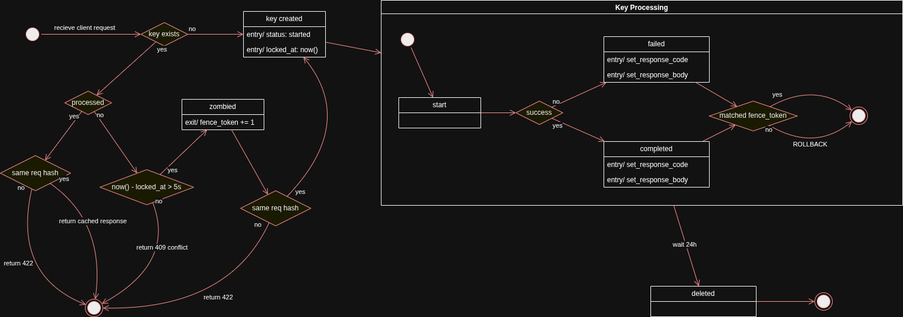
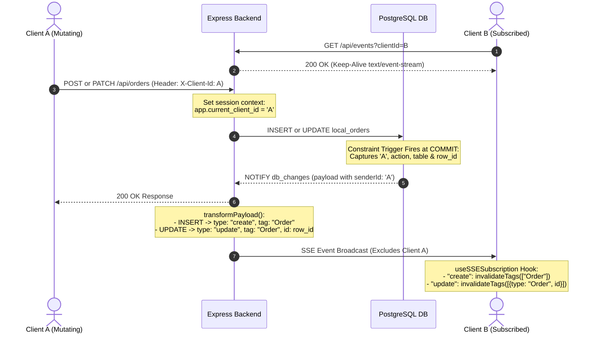
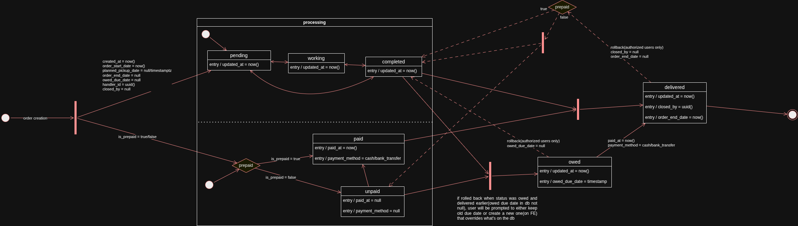
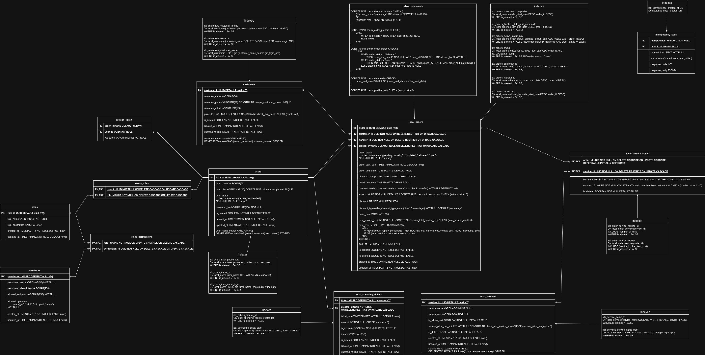
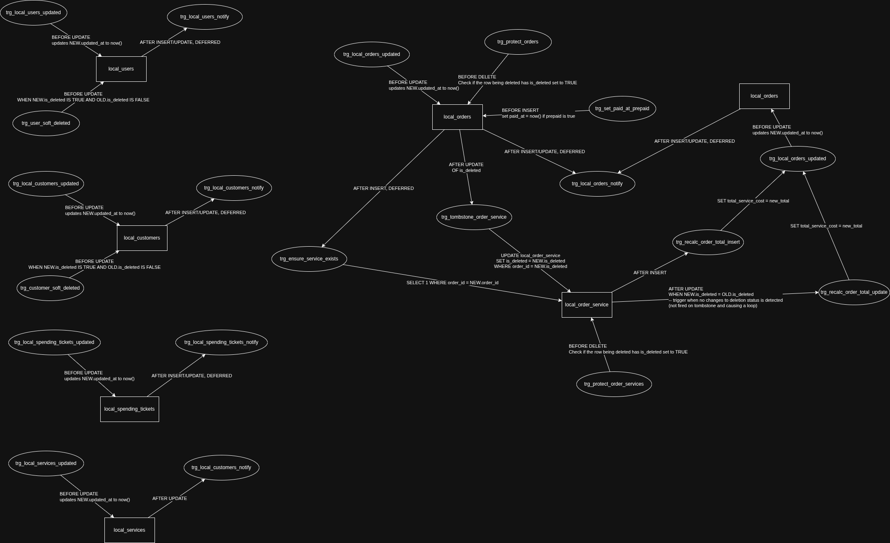

# Point-of-Sale & Service CRM System

An event-driven Point-of-Sale (POS) and Customer Relationship Management (CRM) platform for small, localized deployments (an on-premise mini-PC serving a LAN). It is built around database-enforced invariants, idempotent writes, real-time cache synchronization, and indexed queries that stay fast at ~100,000 orders.

> **Status: paused.** The core backend (database engine, idempotency lifecycle, real-time sync, order processing, CRUD modules) is working. The admin Dashboard is still UI placeholders. See [Project Status](#project-status).

<!-- TODO: add 1-2 screenshots or a short GIF of the UI here (e.g. order list, order detail). -->

## Table of Contents

- [Features](#features)
- [Tech Stack](#tech-stack)
- [Getting Started](#getting-started)
- [Project Status](#project-status)
- [Architecture](#architecture)
- [Idempotency Engine & Concurrency Control](#idempotency-engine--concurrency-control)
- [Real-Time Cache Sync](#real-time-cache-sync-postgresql-listennotify--sse)
- [Dual-Track Order State Machine](#dual-track-order-state-machine)
- [Database Design](#database-design)
- [Data Access Strategy](#data-access-strategy)
- [Performance Profiling & Seed Data](#performance-profiling--seed-data)

---

## Features

- **Order management:** create, track, and close service orders with line items, discounts, and extra costs. Totals are computed inside the database.
- **Dual-track order lifecycle:** fulfillment (`pending` ↔ `working` ↔ `completed`) and payment (`unpaid` / `paid`) are tracked separately and join into `delivered` or `owed`, with the rules enforced by database constraints. Authorized users can roll orders back.
- **Customers & loyalty points:** customer records with points earned and redeemed per order, plus debt tracking for orders owed.
- **Service catalog & spending tickets:** price definitions for services, and tickets for recording expenses and income.
- **Staff accounts & access control:** phone-number login, JWT authentication. Stored refresh tokens and role-based permissions defined per endpoint and HTTP method currently only mocked up in database. Accounts can be suspended.
- **Real-time multi-user sync:** changes made at one terminal appear on the others without a manual refresh.
- **Safe retries on an unreliable LAN:** idempotent POST/PATCH requests prevent double-billing and duplicate orders.
- **Vietnamese-aware search & sorting:** accent-insensitive substring search and Vietnamese alphabetical collation.
- **Privacy-minded deletes:** soft-deleting a customer scrubs their personal data.

## Tech Stack

| Layer          | Technology                                                  |
| -------------- | ----------------------------------------------------------- |
| Frontend       | React, Redux Toolkit (RTK Query), Ant Design                |
| Backend        | Node.js, Express.js (repository pattern)                    |
| Database       | PostgreSQL 16+ (PL/pgSQL; extensions `pg_trgm`, `unaccent`) |
| Infrastructure | Docker, Docker Compose, Nginx reverse proxy                 |

---

## Getting Started

### Prerequisites

- [Docker Engine](https://docs.docker.com/get-docker/) v20.10.0+
- [Docker Compose](https://docs.docker.com/compose/install/) v2.0.0+

### Installation

1. **Clone the repository**

    ```bash
    git clone <repository-url>
    cd <repository-folder>
    ```

2. **(Optional) Override the default configuration**

    The app ships with working defaults. To override them, create a `.env` file in the project root:

    ```env
    DB_USER=postgres
    DB_PASSWORD=password123
    DB_NAME=crm_db
    JWT_SECRET=my_demo_secret
    ```

    <!-- TODO: if a .env.example exists in the repo, point to it here and make sure .env is in .gitignore. -->

3. **Start the application**

    ```bash
    docker compose up --build
    ```

    On the **first boot**, PostgreSQL creates the schema and loads ~247,000 rows of mock data from `mockdata.sql`. The backend runs `setup.js`, which polls the database and retries until seeding finishes and the default admin account exists, and only then opens its API port. The first start therefore takes noticeably longer than later ones.

> [!WARNING]
> The credentials and secrets in this README are **for local demos only**. Change `DB_PASSWORD`, `JWT_SECRET`, and the default admin password, and stop publishing the PostgreSQL port, before running this anywhere real.

### Accessing the Services

| Service           | URL / Port                                     | Description           |
| ----------------- | ---------------------------------------------- | --------------------- |
| Frontend          | [http://localhost:3000](http://localhost:3000) | Web application UI    |
| Backend API       | [http://localhost:5000](http://localhost:5000) | Express / Node.js API |
| API Documentation | [http://localhost:8080](http://localhost:8080) | Swagger interface     |
| PostgreSQL        | `localhost:5432`                               | Database server       |

### Default Admin Login

| Field        | Value        |
| ------------ | ------------ |
| Phone number | `0988888888` |
| Password     | `password`   |

### Useful Commands

```bash
# Run in the background
docker compose up -d --build

# Follow logs
docker compose logs -f

# Stop the application (data is kept)
docker compose down

# Stop and DELETE all database data (re-seeds on next start)
docker compose down -v
```

---

## Project Status

This is a stable development snapshot, currently on hold.

**Working**

- Database engine, triggers, and constraints
- Idempotency lifecycle
- Real-time SSE sync
- Order processing and CRUD modules

**Known limitations**

- **Dashboard:** the main Dashboard view (`/admin/.../dashboard`) shows UI placeholders and is not yet connected to live API metrics. To try the integrated workflows, log in with the default admin account and use the topbar menu to reach the other pages.

<!-- TODO: add a short Roadmap (e.g. wire up Dashboard metrics) and a License section. -->

---

## Architecture

```
          +-----------------------+
          |   React + RTK Query   |
          |  (AntD UI Component)  |
          +-----------+-----------+
                      |
              HTTP / SSE Stream
                      |
          +-----------v-----------+
          |      Nginx Proxy      |
          +-----------+-----------+
                      |
          +-----------v-----------+
          |   Node.js / Express   |
          |  (Repository Pattern) |
          +-----------+-----------+
                      |
             pg Pool / Session
                      |
          +-----------v-----------+
          |  PostgreSQL Database  |
          | (Triggers, Constraints|
          |    LISTEN / NOTIFY)   |
          +-----------------------+
```

Business rules live as close to the data as possible: constraints, generated columns, and triggers guarantee correctness even if application code has a bug.

---

## Idempotency Engine & Concurrency Control

To prevent double-billing, duplicate orders over an unreliable LAN, and race conditions between concurrent cashiers, core transactions combine a PostgreSQL-backed idempotency layer with explicit row-level lock modes.

### Idempotency Engine & Lock Stealing

POST/PATCH requests pass through an idempotency layer that hashes the request payload and recovers from stale locks. Click the diagram for full size.

[](design/idempotency_key_life_cycle.drawio.png)

How a request carrying an idempotency key is handled:

| Situation                                               | Result                                                                                     |
| ------------------------------------------------------- | ------------------------------------------------------------------------------------------ |
| Key not seen before                                     | A key is created (`status = started`, `locked_at = now()`) and the request is processed    |
| Already processed, same payload                         | The stored response is returned without re-running the request                             |
| Already processed, different payload                    | `422`                                                                                      |
| Still `started`, lock younger than 5 s                  | `409 Conflict` (the original request is still in flight)                                   |
| Still `started`, lock older than 5 s, same payload      | The stale lock is stolen (`fence_token` is incremented) and the request is processed again |
| Still `started`, lock older than 5 s, different payload | `422`                                                                                      |

Lock reservation and stealing happen in a single atomic `UPSERT`:

```sql
INSERT INTO idempotency_keys (idempotency_key, user_id, request_hash, status, locked_at)
VALUES ($1, $2, $3, 'started', CURRENT_TIMESTAMP)
ON CONFLICT (user_id, idempotency_key)
DO UPDATE SET
  locked_at = EXCLUDED.locked_at,
  fence_token = idempotency_keys.fence_token + 1
WHERE
  idempotency_keys.status = 'started'
  AND idempotency_keys.locked_at < (CURRENT_TIMESTAMP - INTERVAL '5 seconds')
RETURNING *;
```

**Key properties**

- **Atomic lock stealing:** if a backend process crashes mid-request, a lock stuck in `started` for more than 5 seconds can be taken over by the next retry.
- **Fencing:** every steal increments `fence_token`. When processing finishes, the result is only committed if the request's fence token still matches the stored one; otherwise the transaction is rolled back. A slow original request therefore cannot overwrite the work of the retry that replaced it.
- **Payload verification (`request_hash`):** reusing a key with a different request body is rejected with `422`.
- **Stored outcomes:** both successful and failed results save their response code and body (`response_code`, `response_body`), so a retry gets the same answer.
- **Transaction binding:** key completion (`updateSuccess`) uses the same database transaction (`client`) as the business operation, so the key is marked complete atomically with the domain records.
- **Expiry:** keys are deleted 24 hours after creation (`idx_idempotency_created_at` supports the cleanup).

### Explicit Pessimistic Locking

Inside `OrderService`, reads use targeted PostgreSQL lock modes:

- **`FOR NO KEY UPDATE` (mutation and state locks):** taken on customer rows (`lockCustomerById`) before loyalty points (`points_used` / `points_earned`) change, and on order rows (`fetchAndLockOrder`) during status updates (`updateStatus`) and soft deletes (`removeOrder`). This blocks concurrent modification of the same row while avoiding unnecessary contention with foreign-key checks on related tables.
- **`FOR SHARE` (shared guard locks):** taken on staff profiles (`users`, via `lockHandlerAndCheckExistence`) and service prices (`local_services`, via `checkServicesAndLock`) during order creation. An administrator cannot edit those rows mid-transaction, while other cashiers can still read the same reference data concurrently.

---

## Real-Time Cache Sync (PostgreSQL LISTEN/NOTIFY + SSE)

Instead of WebSockets, client state is synchronized with PostgreSQL's native pub/sub (`LISTEN`/`NOTIFY`) bridged to the browser through Server-Sent Events (SSE).



**Implementation details**

- **Deferred constraint triggers:** notifications come from `CONSTRAINT TRIGGER ... DEFERRABLE INITIALLY DEFERRED`, so they fire at commit time, after other cascading triggers (such as order-total recalculation) have run. The payload therefore reflects the final state of the row. Notifications are also only delivered if the transaction commits.
- **Echo suppression:** the trigger reads session metadata (`current_setting('app.current_client_id', true)`) and stamps the payload with `senderId`. Express skips the originating client, avoiding a redundant re-fetch.
- **Coverage:** notify triggers exist on users, customers, orders, spending tickets, and services.
- **RTK Query cache mapping:** database tables map to frontend cache tags (for example `local_orders` → `Order`), so only the affected cache entries are invalidated.

---

## Dual-Track Order State Machine

Fulfillment and payment are tracked as two parallel tracks that join when an order is closed. The database enforces the rules on both. Click the diagram for full size.

[](design/order_life_cycle.drawio.png)

### Creation

New orders start as `pending` with `order_start_date = now()`, and with `order_end_date`, `owed_due_date`, and `closed_by` all null. `is_prepaid` decides where the payment track starts: prepaid orders begin as **paid** (`paid_at = now()`), all others as **unpaid**.

### The two tracks

| Track       | States                              | Notes                                                                             |
| ----------- | ----------------------------------- | --------------------------------------------------------------------------------- |
| Fulfillment | `pending` ↔ `working` ↔ `completed` | Orders can move back and forth between these three                                |
| Payment     | `unpaid` → `paid`                   | Recording payment sets `paid_at` and `payment_method` (`cash` or `bank_transfer`) |

### Closing an order

| From                   | To          | Effect                                                                                               |
| ---------------------- | ----------- | ---------------------------------------------------------------------------------------------------- |
| `completed` and paid   | `delivered` | Sets `closed_by` and `order_end_date = now()`                                                        |
| `completed` and unpaid | `owed`      | The customer takes the order and pays later; sets `owed_due_date`                                    |
| `owed`                 | `delivered` | When payment is recorded: sets `paid_at` and `payment_method`, then `closed_by` and `order_end_date` |

### Rollbacks (authorized users only)

- **`delivered` → `completed`:** clears `closed_by` and `order_end_date`. Prepaid orders stay paid; all others go back to unpaid.
- **`owed` → `completed`:** clears `owed_due_date`.
- If an order that was previously `owed` and then `delivered` is rolled back and still has an `owed_due_date` stored, the frontend asks whether to keep the old due date or enter a new one, which then overrides the stored value.

### Database-enforced invariants

- **Prepaid:** `is_prepaid = TRUE` requires `paid_at` to be set (`check_order_prepaid`).
- **Delivered:** requires non-null `order_end_date`, `paid_at`, and `closed_by` (`check_order_status`).
- **Owed:** requires `paid_at`, `closed_by`, and `order_end_date` to be null, and the order must not be prepaid. Prepaid orders can therefore never be owed.
- **All other states:** `closed_by` and `order_end_date` must be null.
- **Dates:** `order_end_date` must be later than `order_start_date` (`check_date_order`).

---

## Database Design

Click a diagram to open it full size.

[](design/POS_Physical_ERD.drawio.png)

[](design/Trigger_dependency.drawio.png)

### Core Model

- **Orders:** each order references a customer, the staff member handling it (`handler_id`), and the staff member who closed it (`closed_by`). Line items live in `local_order_service`, keyed by (`order_id`, `service_id`), and point at the service catalog (`local_services`).
- **Foreign keys:** customers, staff, and services use `ON DELETE RESTRICT`. Line items cascade with their order, and that foreign key is `DEFERRABLE INITIALLY DEFERRED`.
- **Spending tickets:** expense or income records (`is_expense`) created by a staff member.
- **Access control:** users ↔ roles ↔ permissions through join tables. A permission is an endpoint plus an HTTP method (`get`, `post`, `put`, `patch`, `delete`). Refresh tokens are stored per user.
- **Idempotency keys:** one row per (key, user), holding the request hash, status (`started` / `completed` / `failed`), and the stored response.
- **Primary keys:** UUIDv7 throughout.

### Declarative Constraints

Beyond the order-state rules above, the schema enforces:

- **Discounts:** percentage discounts must be between 0 and 100, fixed discounts must be non-negative (`check_discount_bounds`).
- **Totals:** `total_cost` and `total_service_cost` must be greater than 0 (`check_positive_total`).
- **Positive amounts:** customer points and extra cost cannot be negative, and line-item cost, unit counts, service prices, and ticket amounts must be greater than 0.

### Triggers

The dependency graph shows every trigger. By purpose:

| Purpose              | Triggers                                                                            | Behavior                                                                                                                                                                      |
| -------------------- | ----------------------------------------------------------------------------------- | ----------------------------------------------------------------------------------------------------------------------------------------------------------------------------- |
| Timestamps           | `trg_*_updated` (one per table)                                                     | BEFORE UPDATE: sets `updated_at = now()`                                                                                                                                      |
| Change notifications | `trg_*_notify` on users, customers, orders, spending tickets, services              | AFTER INSERT/UPDATE, deferred to commit (services: AFTER UPDATE). Feeds the real-time sync                                                                                    |
| Soft delete          | `trg_user_soft_deleted`, `trg_customer_soft_deleted`, `trg_tombstone_order_service` | When `is_deleted` changes from FALSE to TRUE on a user or customer (customers are scrubbed, see below), and when an order is soft-deleted its line items are soft-deleted too |
| Delete protection    | `trg_protect_orders`, `trg_protect_order_services`                                  | BEFORE DELETE: only rows already marked `is_deleted = TRUE` can be removed                                                                                                    |
| Order integrity      | `trg_set_paid_at_prepaid`, `trg_ensure_service_exists`                              | Prepaid orders get `paid_at = now()` on insert; at commit, a new order is checked for line items                                                                              |
| Total recalculation  | `trg_recalc_order_total_insert`, `trg_recalc_order_total_update`                    | AFTER INSERT/UPDATE on line items: updates the order's `total_service_cost`                                                                                                   |

#### Recursive loop guards

Soft-deleting an order cascades `is_deleted` to its line items (`trg_tombstone_order_service`). Each of those updates would normally fire the total-recalculation trigger, which updates the order again. The update trigger therefore only fires when `is_deleted` is unchanged:

```sql
CREATE TRIGGER trg_recalc_order_total_update
AFTER UPDATE ON local_order_service
FOR EACH ROW
WHEN (NEW.is_deleted = OLD.is_deleted) -- Suppresses cascade when soft-deleting
EXECUTE FUNCTION update_order_total_service_cost();
```

### Generated Columns

Financial totals are calculated in the table definition itself:

```sql
-- Generated total cost
total_cost INT GENERATED ALWAYS AS (
    CASE
        WHEN discount_type = 'percentage' THEN ROUND((total_service_cost + extra_cost) * (100.0 - discount) / 100.0)
        ELSE (total_service_cost + extra_cost - discount)
    END
) STORED
```

### Soft-Delete PII Scrubbing

Setting `is_deleted = TRUE` on a customer anonymizes their personal data through a PL/pgSQL trigger:

```sql
CREATE OR REPLACE FUNCTION soft_delete_customer()
RETURNS TRIGGER AS $$
BEGIN
  NEW.customer_name := NULL;
  NEW.customer_phone := NULL;
  NEW.customer_address := NULL;
  NEW.points := 0;
  RETURN NEW;
END;
$$ LANGUAGE plpgsql;
```

### Indexing Strategy

All indexes are partial (`WHERE is_deleted = FALSE`), so soft-deleted rows never bloat lookup paths. The patterns below are grouped by what they optimize. The same patterns repeat on other tables (orders by start date, finish date, handler, and closer; users and services by Vietnamese name and trigram; spending tickets by creator and date; idempotency keys by creation time), and the ERD lists them all.

#### A. Covering partial indexes (`INCLUDE`)

Covering payloads let PostgreSQL answer hot queries with **Index-Only Scans**, without visiting table pages. This depends on the visibility map being current, so regular vacuuming matters.

Debt lookups:

```sql
CREATE INDEX idx_orders_owed ON local_orders (customer_id, owed_due_date ASC, order_id ASC)
INCLUDE (total_cost)
WHERE is_deleted = FALSE AND order_status = 'owed';
```

Line-item joins:

```sql
CREATE INDEX idx_order_service_lookup ON local_order_service (order_id)
INCLUDE (service_id, line_item_cost)
WHERE is_deleted = FALSE;
```

#### B. Active-state queue navigation

Worker dashboards only care about active orders, so this index excludes terminal states (`delivered`, `owed`). It stays small and speeds up the priority pickup queue (`NULLS LAST` ordering):

```sql
CREATE INDEX idx_orders_active_status_nav ON local_orders (
    order_status,
    planned_pickup_date ASC NULLS LAST,
    order_id ASC
)
WHERE is_deleted = FALSE AND order_status != 'delivered' AND order_status != 'owed';
```

#### C. Keyset pagination and locale-aware indexes

These support cursor pagination in $O(\log N)$ without sorting overhead or `OFFSET` drift.

Vietnamese alphabetical collation:

```sql
CREATE INDEX idx_customers_name_vi ON customers (customer_name COLLATE "vi-VN-x-icu" ASC, customer_id ASC)
WHERE is_deleted = FALSE;
```

Multi-column cursor:

```sql
CREATE INDEX idx_orders_customer_id ON local_orders (customer_id, order_start_date DESC, order_id DESC)
WHERE is_deleted = FALSE;
```

#### D. GIN trigram indexes (substring search)

Wildcard searches (`ILIKE '%term%'`) avoid full sequential scans by using a GIN trigram index over an unaccented, generated search column:

```sql
CREATE INDEX idx_customers_customer_name ON customers
USING gin (customer_name_search gin_trgm_ops)
WHERE is_deleted = FALSE;
```

Search terms shorter than 3 characters produce no usable trigrams, so PostgreSQL may fall back to a scan for those.

#### E. Byte-level and prefix-optimized B-trees

These skip locale-aware comparison for numeric strings and prefix matching.

Phone lookups with `COLLATE "C"` (plain byte comparison):

```sql
CREATE INDEX IF NOT EXISTS idx_customers_customer_phone
ON customers(customer_phone COLLATE "C" ASC, customer_id ASC)
WHERE is_deleted = FALSE;
```

Prefix matching (`LIKE '098%'`) with `text_pattern_ops`:

```sql
CREATE INDEX IF NOT EXISTS idx_users_user_phone_role
ON users(user_phone text_pattern_ops, user_role)
WHERE is_deleted = FALSE;
```

---

## Data Access Strategy

### Cursor-based (keyset) pagination

List endpoints use base64-encoded cursor tokens that carry a primary sort value and a unique tiebreaker ID (`cursorValue` + `cursorId`).

- **$O(\log N)$ page lookup:** instead of `OFFSET N LIMIT M`, which scans and discards N rows, the query jumps straight to the cursor position in the index.
- **Stable pages under concurrent writes:** new records and soft deletes don't cause skipped or duplicated rows, because each page starts from a fixed position. Results can still reorder if the sort column itself is edited between requests.

---

## Performance Profiling & Seed Data

Query performance was checked against a generated seed dataset (`mockdata.sql`) that simulates several years of activity.

### Dataset composition

| Table                    | Rows     | Notes                                                    |
| ------------------------ | -------- | -------------------------------------------------------- |
| `local_orders`           | 100,000  | Spanning 7 years of history                              |
| `local_order_service`    | 140,000+ | Line items                                               |
| `customers`              | 2,000    | Pareto distribution: 5% VIP, 15% Regular, 80% Occasional |
| `local_spending_tickets` | 5,000    | Financial records                                        |

### Execution plan checks

Indexes were checked with `EXPLAIN ANALYZE` after running `ANALYZE` to refresh statistics:

- **B-tree lookups:** phone lookups, primary-key fetches, and debt tracking moved from sequential scans to index scans on the 100k-order dataset.
- **Index-only scans:** debt lookups use an Index-Only Scan through the covering partial index `idx_orders_owed`.
- **Trigram bitmap scans:** `ILIKE '%abc%'` searches use GIN trigram bitmap scans over the unaccented text columns instead of sequential scans.

<!-- TODO: add measured results (before/after timings or a trimmed EXPLAIN ANALYZE output) so these claims can be checked. -->

---

## Acknowledgements

This project was built with AI assistance. The code and the initial README were
generated with assistance from Google Gemini (Gemini 3.5 Flash-Lite) on the free tier, and the README
was later revised with Anthropic's Claude. The system design (schema, state
machines, and diagrams) and the decisions behind them are mine. The code has not
been fully audited, so some details may be inaccurate. See [Project Status](#project-status).
